

<h1 align="center">Afflatus</h1>

  ComfyUI's models, without living in the graph. 
  A studio with a library, a form per model and a timeline that makes real videos. Free, on your own PC.

  
  
  

<!-- the hero video: hero8 (2026-10-10), kept for 0.6.0; a new film comes in a later release -->
https://github.com/user-attachments/assets/e217e91c-bbf2-4642-8468-3176c35368ca

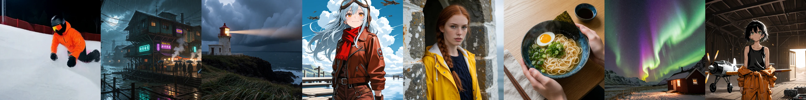

All of it made in Afflatus, on one home GPU and a few rented hours. The logo too.

You keep ComfyUI, your models and your node packs; they do all the rendering. Afflatus is the studio around them: a library where every render is kept with its settings, a clean form for each model, a timeline that turns clips into a film, and one queue that sends each job to whichever GPU will finish it first, yours or one you rent for the afternoon.

It is one small server and a folder of data, on your PC or in a container.

## What's new in 0.7

- **LTX Lip sync on 2.3 and 2.5**, and a recording cut into LTX clips, each as long as its part.
- **Seamless LTX joins:** the next clip carries on in the clip before's latent, with its sound and colour, and a run-up of 9, 25 or 41 frames.
- **Any form under a recording:** a clip can be Lip sync, or a Video with audio (H3, LTX) or Wan clip the recording plays over unchanged.
- **Sound cues:** a part of a sound file pinned at a moment of the clip, on every H3 form and on LTX.
- **LTX 2.5 with the cast's pictures and voice** (MSR), the face score on LTX and Wan takes, Face refine on LTX 2.5.
- **Wan carries on** from the clip before through SVI 2.0 Pro instead of restarting on a still frame.
- **Record a voice from the microphone** into any sound slot, with Trim the silence.
- **The files of a render checked together** before it runs: another version's VAE, encoder or LoRA said in words.
- **Each take shows what it was made with**, and Use this take's settings.

Everything else is in the [changelog](CHANGELOG.md).

## Make

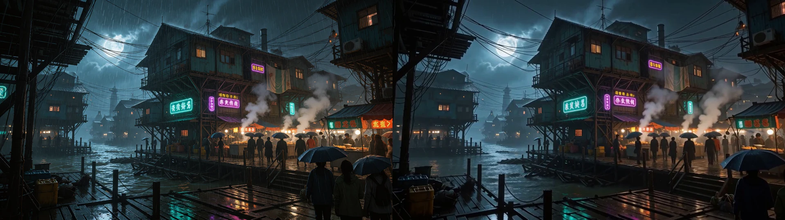 A picture, then the video made from it.

- **A form per model, on its authors' settings.** Prompt, size, steps, done. SDXL, FLUX, Krea 2, Qwen Image, Z-Image for pictures; MiniMax H3, LTX 2.3 and 2.5, Wan 2.2 for video; SCAIL-2 for motion. A `?` beside each model says what it is good and weak at.
- **A designer that knows each model's grammar.** Point it at any OpenAI-style endpoint (LM Studio, Ollama, llama.cpp or a service) and it writes the prompt the way that model reads one: tags for SDXL, one flowing description with no quality words for Krea 2, each from a prompting guide you can read and edit. Your own system prompts shape it further, a photographer, a videomaker; it can plan a whole timeline as a series of clips; and what it writes is checked against the model's rules, each miss shown as a line for you to judge.
- **A library you can keep tidy.** Projects, with folders inside them. Renders land in the folder you are working in; drag anything anywhere; and one search box finds anything across all of it, by what it is: `video: lantern`, `model:krea2 since:1m`, `in:"The Keeper" -kept`, `lora:` to list the LoRAs you have used, `prompt:` for the words you wrote. Open an item and the viewer shows everything that made it: model, seed, every setting, the pictures it was fed.
- **Drafts that outlive the render.** A draft is a prompt and its inputs, kept until you delete it. Run the same one on Krea 2, then on Z-Image, then on FLUX, and compare any two results side by side with a wipe. Reuse a render's seed, or make a variation of it, in one click.
- **Video, every way you need it, each a clean form.** A picture moves, pinned to a first frame, a last frame or a keyframe in between, with its own sound on MiniMax H3 and LTX. A source video lends your picture its motion: a dance, a walk, someone talking (SCAIL-2 for several people at once, or MiniMax H3 · Motion transfer, held to the source's pose). Swap character puts someone of your cast, or the person in a reference picture, in place of the one in a video, with the scene, the motion and the sound kept. And when the words have to be a particular voice, Lip sync makes a MiniMax H3 shot around your recording: pick the part on its waveform, and the mouth follows it.
- **Faces that hold.** Face refine finds the face in every frame and draws it again towards the person's own picture, the clip's sound held so the mouth stays on it: in a form's Output, on a take, or at the Finish. Every take says how close its face is to the person, so the best one is a sort away.
- **Your cast, written once.** The Prompt kit holds your people, places and styles. A person is a few pictures, how they look as tags and as a sentence, a voice, their outfits, and a LoRA per model when you have one; that is what keeps her the same from one render to the next. Put *her, in the summer dress, film look* into a draft or a whole timeline, and each model gets it the way it reads it: tags for SDXL, a sentence and reference pictures for Krea 2 or MiniMax H3, the voice when the clip has to speak. On MiniMax H3 the prompt comes in parts, who is in the source, how they look and what happens, with `@Name` for anyone in the kit and a shot size, and Afflatus writes the prompt the model reads from them, shown as it is sent. Snippets drop into any prompt by name, a Roll picks one of each kind at random, and a preset keeps a whole setup, model and cast included, as a file you can share.
- **The usual tools, on the right-click.** Upscale, inpaint, outpaint, edit by instruction, fix a face or a hand, a ControlNet guide, remove a background, mirror; trim a video or a sound, save a frame, take the sound out.
- **Models that come to you.** Settings → Models says, per family and per operation, what is ready, what is missing and the folder it goes in, with a Download button beside it: the file goes straight into ComfyUI's folders, two at a time, resumed if the line drops, and checked against Hugging Face's own hash where it gives one. The same for a pod.
- **And models you can find again.** Find models browses Civitai and Hugging Face from inside the app, filtered to the families you run, and gets a model onto this PC, onto a pod, or into a set. Your own checkpoints and LoRAs are hashed in the background, so the LoRA with the unreadable file name is matched to its Civitai page, Afflatus knows which files a pod can fetch for itself and which must travel from your PC, and a check you can run daily says which of your models have a newer version.

## Film

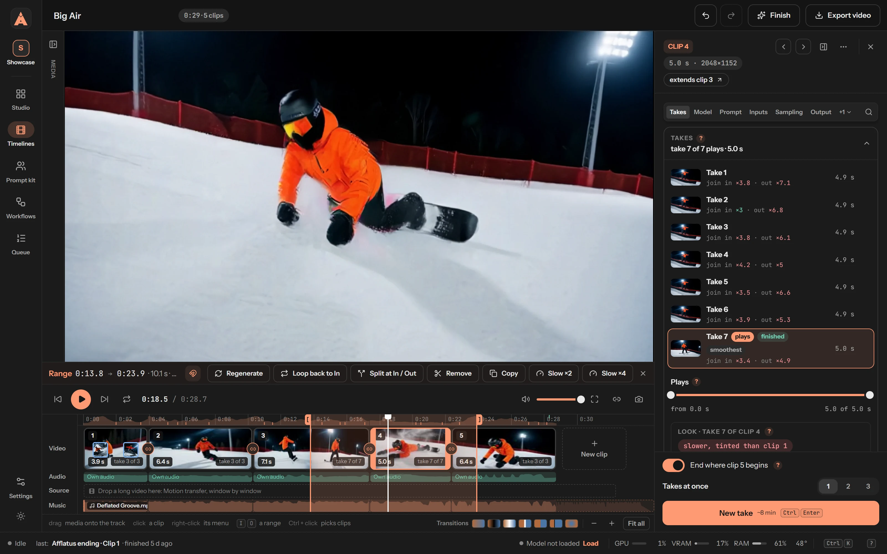

Clips are easy to make. A film is the hard part, and that is what the timeline is for.

- **Any clip after any other.** Hover a join and press **+**: the new clip can be any model, and its list says beside each how it would meet the clip before. MiniMax H3's forms carry on in the model's own latent, so the motion and the sound flow across the cut as one shot: a talking clip, a lip-synced line, a swap and a motion transfer, one after the other. LTX and SCAIL-2 carry on from the clip before's last frames, Wan from its last frame. Where the model family changes, it is a cut, or a transition: dissolve, dip to black or white, flash, wipe, slide, circle, zoom.
- **A long video becomes a sequence.** Drop it on the Source lane and it is cut into windows, each a clip that carries on from the last: a Swap character where a shot opens and Motion transfer where it carries on, or SCAIL-2 throughout, each window's form yours to change. Drop a voice recording on the Audio lane and it becomes Lip sync clips, cut at its pauses. Both stay trimmable on their lane, the windows past a shortened end set aside with their takes and back when it grows again.
- **Takes, not re-rolls.** Each clip is a form of its own. Render three takes at once; each is listed with how cleanly it joins in and out and how close its face is to the person, the smoothest is marked, you pick the one that plays, and the rest wait on the shelf for a later cut.
- **Regenerate a range.** Mark two seconds, inside a clip or across the join of two, and press Regenerate: a new clip is made for that stretch, joined to the clips on both sides, and the rest of the timeline stays as it was.

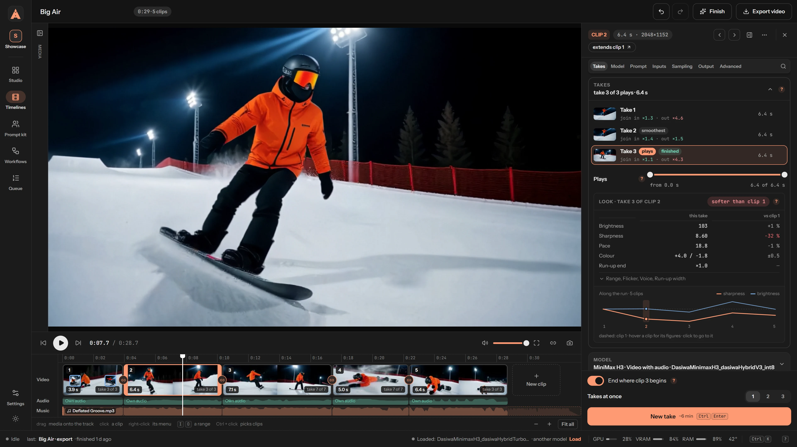

- **Measured, not eyeballed.** Every take carries the figures of its joins, in and out, and of its look against the clip before and the start of its run: brightness, sharpness, grain, pace, colour, flicker, and the face against the person's own pictures when there is one. The figures come from the frames, and a chart follows them along the run. When a join jumps, the timeline names the take that would join more cleanly; the call stays yours.
- **The rest of an editor.** Ranges that snap to the quiet moments and the cuts, split at the playhead, stills held on screen, slow motion, loops, music that ducks under voices.
- **Finish and export.** Finish brings every clip to its final size in one go (SeedVR2, RTX Video Super Resolution, an upscale model, or a re-sample of an H3 clip's own latent), with Face refine on the clips that have a person; a finished take keeps its draft's timing. Export one video, a small copy for the web, or a zip for DaVinci Resolve, Premiere Pro or Kdenlive: every clip's whole file with its in and out points, the sound and the music, nothing rendered twice.

## Run

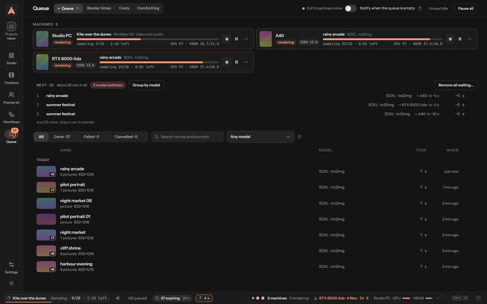

- **One smart queue.** Add every ComfyUI you have: a second GPU, another PC, a rented pod. Each job goes to the machine that will finish it first, counting whether that machine already holds the model and how fast it has been on your own renders. Pin a job to a machine, or send a whole timeline there.
- **You see where the time went.** Before you press Render, the form says how long it will take, from your past renders on that machine. Afterwards, **Render times** accounts for every minute: GPU time, jobs and video made over any period, how much went to loading models, how far off the estimates were, the queue's waits, VRAM peaks and out-of-memory stops; per model, its share, its usual time and whether it ran slower than usual; a lane per model you can drag to zoom; and flags that name what went wrong and offer the fix, sort the queue by model, open the log. On every machine you run, rented ones included.
- **And what it cost.** The **Costs** page takes RunPod's own bill and splits it: today, the month, where the month will end at this pace, your balance and how long it lasts. Then where the pod time went, rendering, booting, fetching files, sitting idle, failing, and how much of it made nothing; the spend per day and per GPU; per project; every pod session from its deploy to its end; what a render of each model costs on each machine, your own PC included once you give it a price per kWh; and what would have cost less: a shorter idle wait with the saving counted, fewer deploys, a network volume for files fetched again and again, a cheaper GPU for that model.
- **Node packs that come by themselves.** An option that needs a node pack the machine lacks (Face refine, Veda, RTX upscaling…) holds its job and says so: **Install and restart** in one click, or set the machine to do it always. ComfyUI is restarted only once nothing renders there, and what cannot come is done without, said on the job.
- **Told when it matters.** A render failed or stuck, the queue empty, a GPU found, a pod stopped, a cap or a low balance reached, a new device signed in: in the browser, on Telegram or on Discord, each kind on or off.

### A GPU for the afternoon

No big card, or a queue longer than the night? Rent one. Afflatus deploys a pod on RunPod with your own key and treats it like any other machine in the queue. Then it takes care of what people dread about renting:

- **Starting it is one dialog.** Pick the GPU, the disk, the idle time and the models to bring. The pod comes up on Afflatus's own image with ComfyUI ready, only its port open and a token in front of it, from its first second; its image pull is followed live, and its CUDA build is the fast one unless you ask.
- **Your models go with it.** The files your waiting jobs need are sent first. A **model set** prepares the pod with the models you always use, and a network volume keeps them between pods. A file comes from Civitai or Hugging Face only when it is proven to be the same bytes as yours; otherwise it travels from your PC. The node packs a job needs are installed on the pod too.
- **The hunt.** Say which GPUs you want, what an hour may cost and how long to try. Afflatus waits, deploys the moment one is free, empties your queue on it, and the idle stop shuts it down. An evening with it, as Telegram told it:
  > **RTX 2000 Ada found.** Deployed in EU-RO-1 at $0.24/h, after 1 min of hunting; 1 render waiting for it.
  > **RTX 2000 Ada terminated.** Why: idle 5 min. This run: $0.04.
- **It stops itself.** After the idle time you set, when Afflatus goes quiet (a watchdog on the pod), when the pod never comes up or its GPU fails. Daily and monthly caps stop the pods once their render ends and refuse new deploys until the day or the month turns.

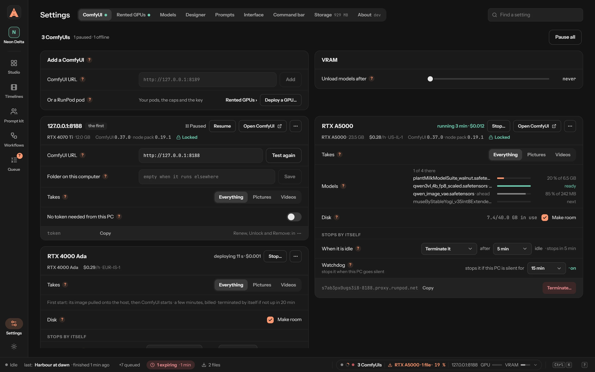 A pod three minutes in: its models arriving, locked, $0.012 so far.

- **You always know.** Telegram or Discord tells you when the hunt found a GPU, when a pod stops and when a cap is reached, and the Costs page shows RunPod's own bill, each render priced at its session's rate.

Your key, RunPod's bill, no account with Afflatus and no cut for anyone. It is off until you paste a key. And any ComfyUI you can reach by an address can already be a machine, wherever it runs; the deploy, the hunt and the bill are RunPod's for now.

## Keep

<table>
<tr>
<td width="50%">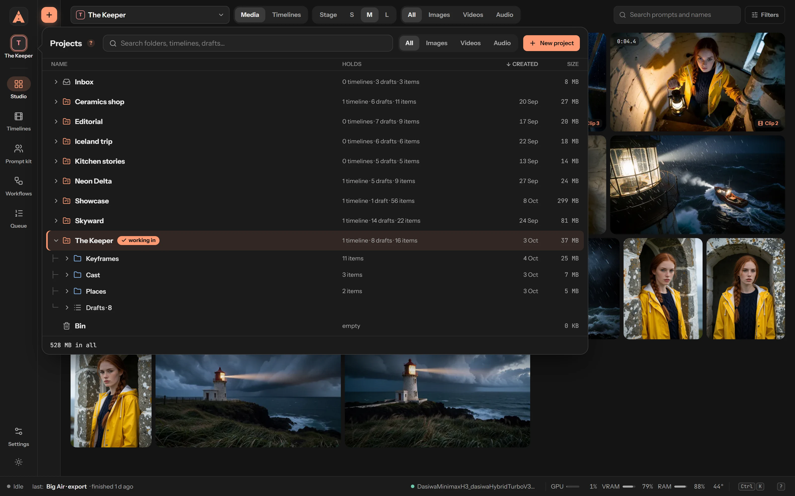 <b>Projects.</b> Folders, drafts and timelines per project, with what each holds and weighs. Renders you don't keep go to the bin after a day and the bin empties itself; Storage shows what takes the space, and takes that never play go to the bin in one click.</td>
<td width="50%">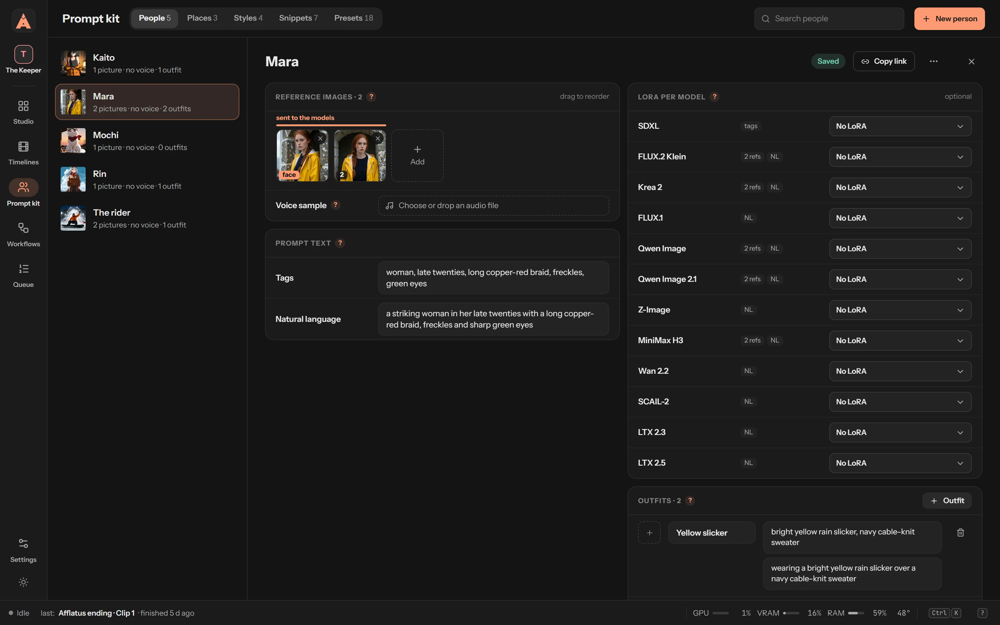 <b>The Prompt kit.</b> One person: her pictures, her words for every model, her voice, her outfits. Every draft and timeline can cast her.</td>
</tr>
<tr>
<td>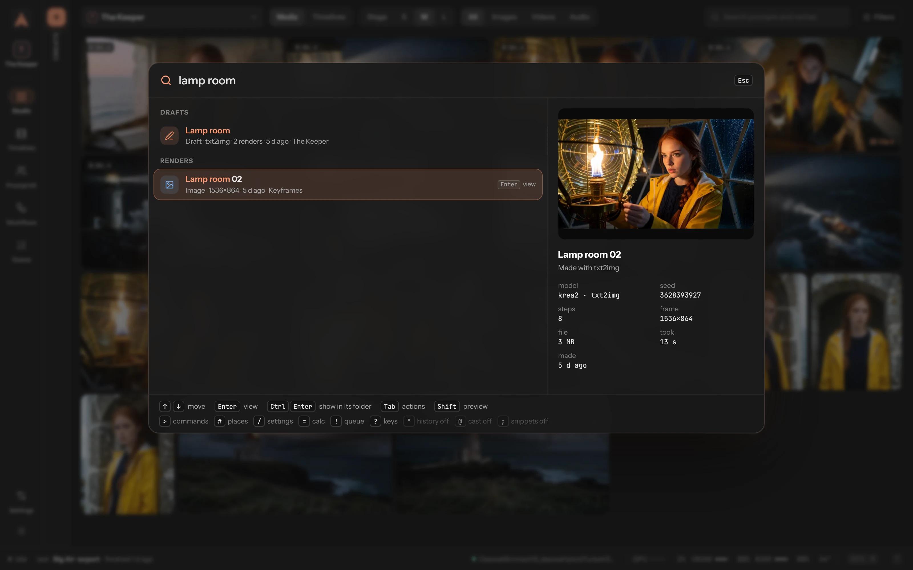 <b>Ctrl+K.</b> One box for everything: find renders by kind, model, LoRA, words, project or date, with a preview; open any setting; queue, reuse, split, deploy a GPU, load a model. Paste a Civitai or Hugging Face link and it reads the model, says which files you have, and downloads the rest.</td>
<td>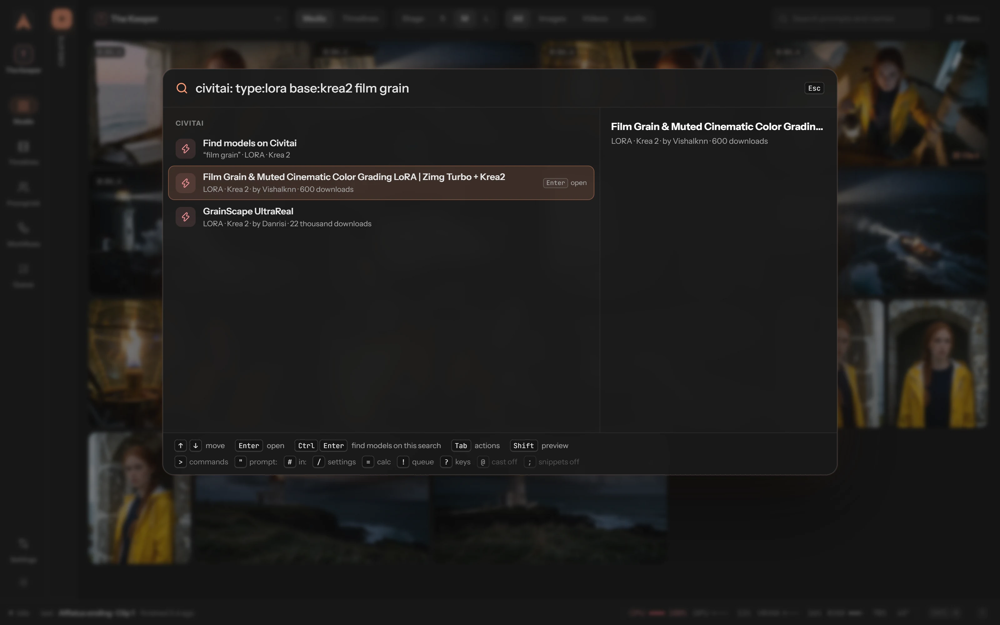 <b>Civitai from the bar.</b> <code>civitai: type:lora base:krea2 film grain</code> and the results are there, with a preview; Enter downloads, Ctrl+Enter opens Find models on the same search.</td>
</tr>
<tr>
<td>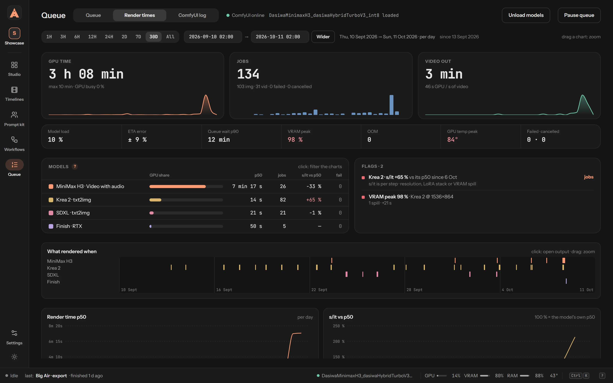 <b>Render times.</b> Every minute of GPU, by machine, model and phase, over a day or a month.</td>
<td>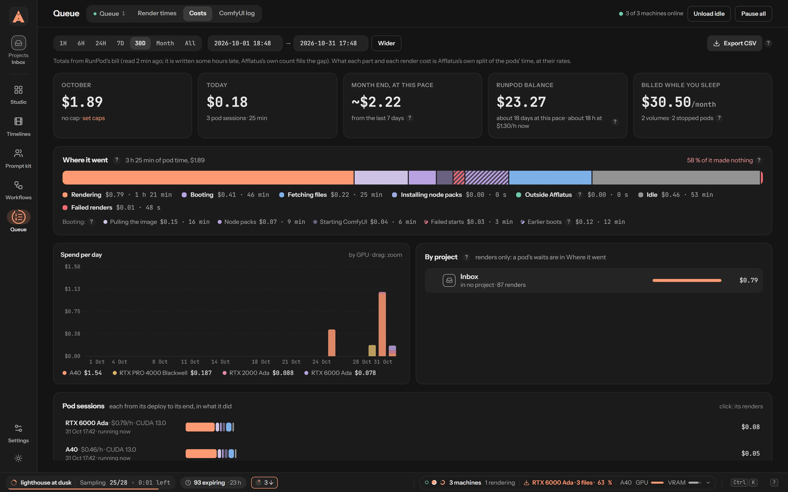 <b>Costs.</b> RunPod's own bill, split: by day and GPU, by project, by pod session, down to what one render of each model cost. And what would have cost less.</td>
</tr>
<tr>
<td>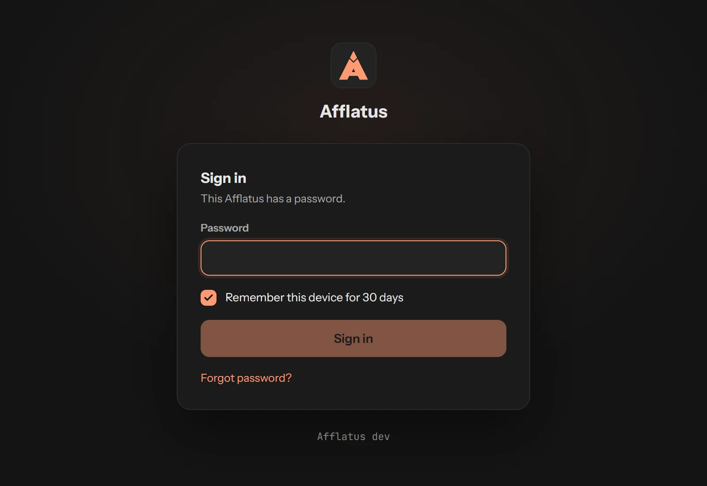 <b>A password, when you want one.</b> Off on your own machine; on, every device signs in once, and you see them all in Settings.</td>
<td>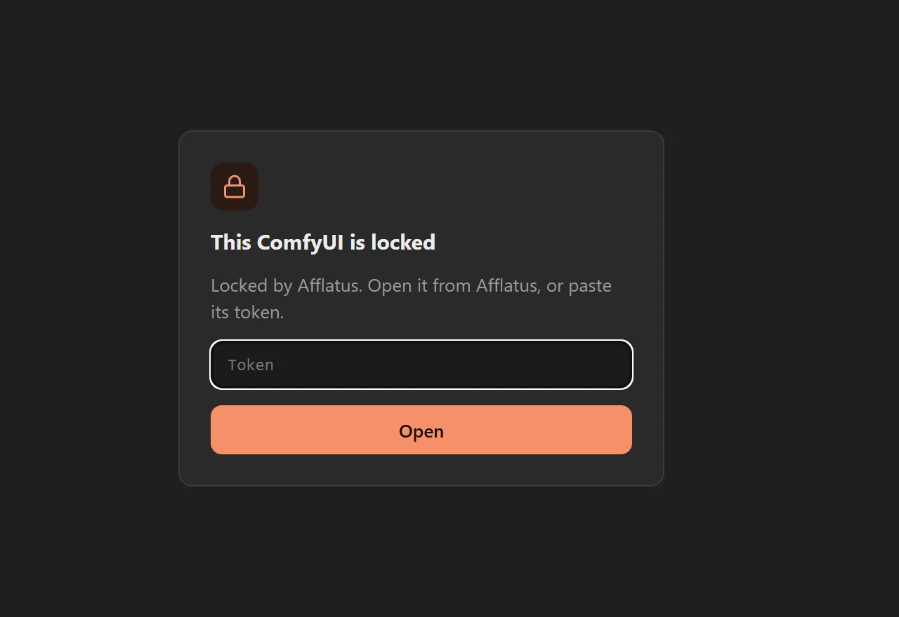 <b>And the ComfyUIs behind it, locked.</b> Afflatus puts a token in front of every ComfyUI it drives, a pod's from its first second. Without it, a browser gets this page and nothing else.</td>
</tr>
<tr>
<td>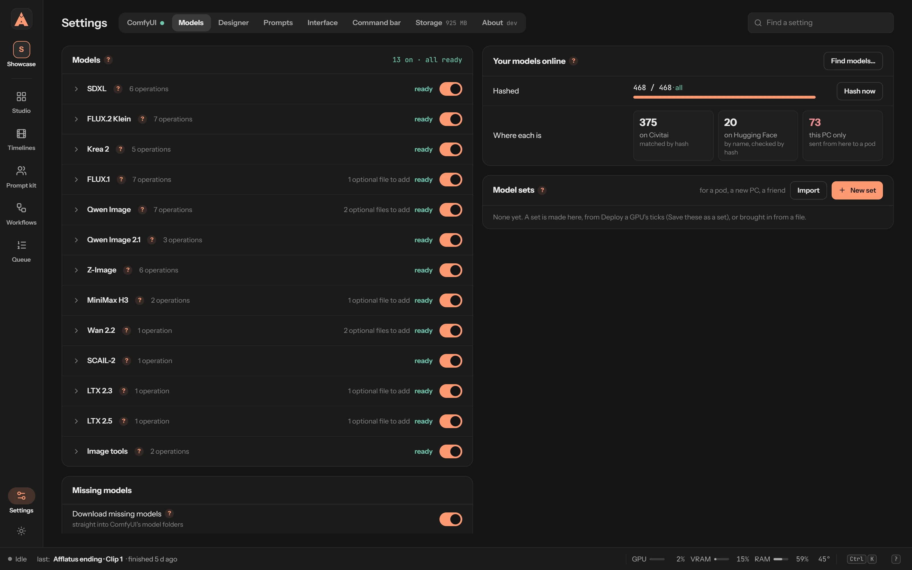 <b>Your models, accounted for.</b> What each family lacks, with the button that fetches it; your own files hashed and matched to their pages.</td>
<td>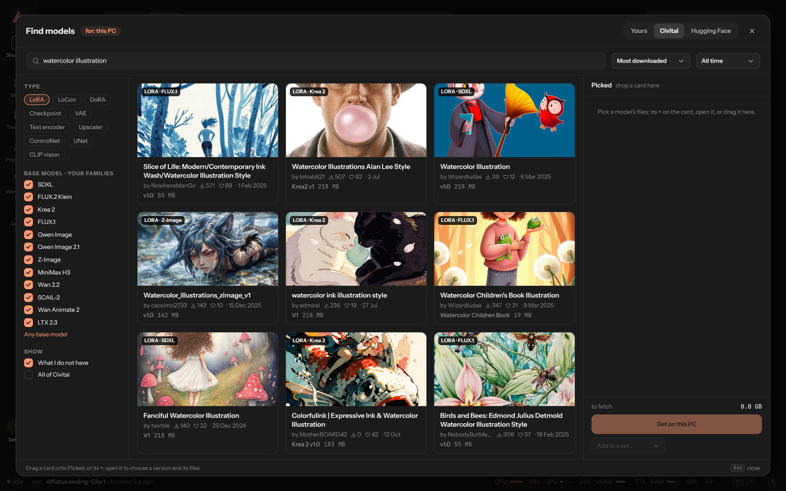 <b>Find models.</b> Civitai and Hugging Face from inside the app, filtered to your families, straight onto this PC, a pod or a set.</td>
</tr>
</table>

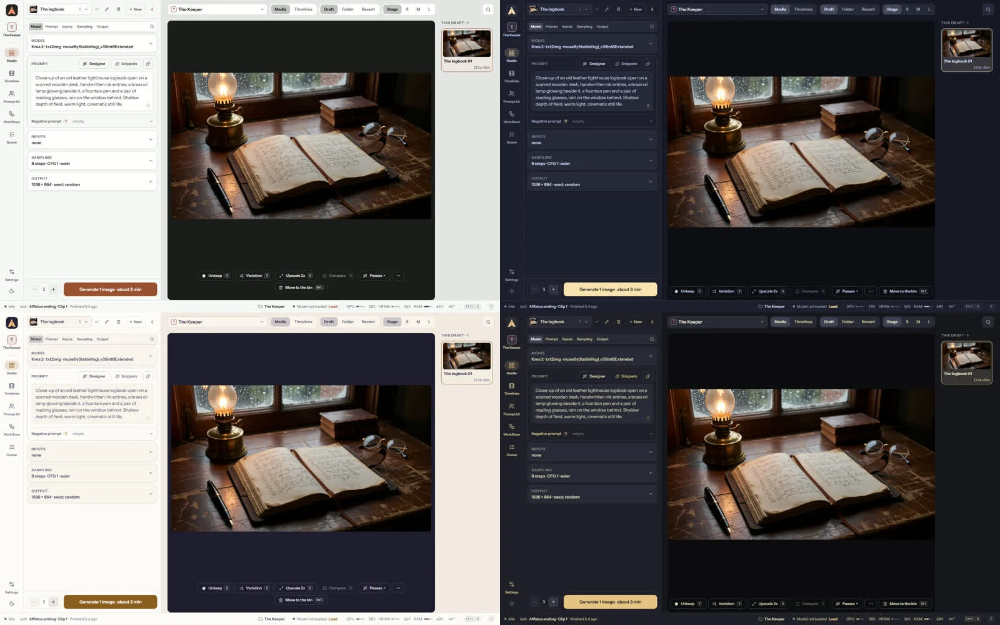 Studio Dark by default, plus Studio Light and the light and dark themes of Catppuccin, Rosé Pine, Tokyo Night and Kanagawa.

## What you stop doing by hand

- Re-typing the settings of a render you liked three weeks ago.
- Wiring a first frame, a last frame and a continuation into a graph for every single clip.
- Watching the clock to know when a render will end.
- Copying forty gigabytes of models to the second machine, or to a pod, by hand.
- Exporting clips one by one for the editor.
- Working out which Civitai page `4xNmKd_v3_fp16.safetensors` came from.
- Checking RunPod's page every ten minutes to see if the pod is still running.
- Hunting down the node pack a workflow needs, installing it and restarting ComfyUI.

## Get started

You need ComfyUI running somewhere (a clone, the portable build or the desktop app) and a card it runs on, or a RunPod account.

1. **Download and start.** Grab the bundle for your system from the [releases page](https://github.com/bardak971/afflatus/releases), unpack it and run `Afflatus.bat` (Windows) or `afflatus.sh` (Linux, macOS). Your browser opens on `http://127.0.0.1:8720`.
2. **Say where you render.** The first page looks for a ComfyUI on this PC and renders on it in one click, its small node pack put in for you (restart ComfyUI once); or takes its address; or goes on with rented GPUs only, your RunPod key and caps asked there. Then **Lock** your ComfyUI so only Afflatus can use it. All of it is in Settings later.
3. **Get a model.** Every form lists its family's official files, the ones you lack greyed with their size and a Download under the field; **Settings → Models** shows them all, file by file, with a search on Civitai and Hugging Face.
4. **Make something.** In the **Studio**, open the form, pick a model, write a prompt and render. Open the result and make it move.

Other ways to run it

| Platform | How |
|---|---|
| Windows | Unzip `afflatus-<version>-win-x64.zip`, double-click `Afflatus\Afflatus.bat` |
| Linux ¹ | `tar xzf afflatus-<version>-linux-x64.tar.gz`, run `Afflatus/afflatus.sh` |
| macOS, Apple Silicon ¹ | `tar xzf afflatus-<version>-darwin-arm64.tar.gz`, run `Afflatus/afflatus.sh`; `brew install ffmpeg` once |
| Docker | `docker run -p 127.0.0.1:8720:8720 -v afflatus-data:/data ghcr.io/bardak971/afflatus:latest`, or the [compose.yaml](compose.yaml) ([guide](docs/install-docker.md)) |
| Kubernetes | the Helm chart in [chart/](chart) ([guide](docs/install-cluster.md)) |
| From the sources | Node 22.16+ and ffmpeg 6.1+ (not 7.0 or 7.1): `corepack pnpm install && corepack pnpm build && corepack pnpm start` |

¹ Built by the release workflow but not yet started on a real machine. Reports welcome.

No GPU at hand? `corepack pnpm demo` runs the real app against a pretend ComfyUI (and, with `DEMO_RUNPOD=1`, a pretend RunPod).

More: [installing on a PC](docs/install-desktop.md) · [setting up ComfyUI](docs/comfyui-setup.md) · [using Afflatus](docs/guide.md) · [configuration](docs/configuration.md) · [troubleshooting](docs/troubleshooting.md)

## The built-in models

Each comes with a form on its authors' own settings; presets for the official releases of most of them, and for DaSiWa's fine-tunes, ship with the Prompt kit.

| Family | Models | What you can do |
|---|---|---|
| SDXL | any SDXL checkpoint: Illustrious, NoobAI, Pony, Juggernaut XL… | txt2img, img2img, inpaint, outpaint, upscale, face and hand refine, a ControlNet guide |
| FLUX.2 Klein | 4B base and its fine-tunes | txt2img, edit by instruction, variation, inpaint, outpaint, upscale, face and hand refine |
| FLUX.1 | dev, Krea dev, schnell, Kontext | txt2img, edit, img2img, inpaint, outpaint, upscale, face and hand refine |
| Krea 2 | Turbo and its fine-tunes | txt2img, img2img, inpaint, upscale, face and hand refine |
| Qwen Image | 2512, Qwen Image Edit | txt2img, edit, img2img, inpaint, outpaint, upscale, face and hand refine |
| Qwen Image 2.1 | | txt2img, edit, the picture for a motion transfer |
| Z-Image | Turbo and its fine-tunes | txt2img, img2img, inpaint, outpaint, upscale, face and hand refine |
| MiniMax H3 | video with sound | text, first and last frame, keyframe, references, continuation, lip sync, character swap, motion transfer, Face refine: the timeline's native model |
| Wan 2.2 | | video from text, a first frame, or first and last frames |
| LTX 2.3 | | video with sound: text, first and last frames, a keyframe in between, continuation |
| LTX 2.5 | | video with sound, LTX's newer model: text, first and last frames, a keyframe, continuation, several shots in one prompt |
| SCAIL-2 | on Wan 2.1 14B | motion transfer, several people: up to 20 s a job at its own 16 fps, or at 24 fps on H3's frames (with Face refine) |
| Image tools | SeedVR2, background removal | restore and upscale, remove the background |

**Your own workflows.** Have a graph you like in ComfyUI? **Workflows → Import** the file it saved. Afflatus reads most of them: the controls their author exposed become a form, switches become toggles, and it names the node packs and model files you are missing. Some graphs need a hand with their mapping before they render; the editor is there for that.

**Model licences.** The models are other people's work under their own licences, which you accept when you download them; each preset shows its licence once. Several limit commercial use, Qwen Image 2.1's weights and the InsightFace models behind the face figures are for research only, Face refine's face finder comes with ultralytics (AGPL-3.0), and **MiniMax H3's licence does not grant its use in the European Union, the United Kingdom, South Korea or the United States**. What you download or export from a render is marked as AI-made: PNG pictures with IPTC's "trained algorithmic media", videos with a comment; what you brought in is never marked.

## Yours, and private

- **Your data** is one folder: the library, settings and timelines (linked folders stay where they are). A backup is one zip from Settings → Storage, without your keys unless you ask for them on the computer it runs on.
- **Nothing leaves your computer** but the daily update check, until you turn something on: model lookups and downloads, Find models, notifications, a hosted language model for the designer, rented GPUs, each with your own key. Keys stay on the server.
- **A password, when you want one.** Off by default, since Afflatus listens on your own machine only. Turn it on in Settings before you open it to your network: each device signs in once and stays signed in for as long as you say, you see every device and can sign any of them out, a new one is announced on Telegram, and a forgotten password is reset with a code sent to your Telegram or written to the server's log. The ComfyUIs it drives can be locked to it with a token, and the pods it deploys on Afflatus's image are locked from their first second. Put HTTPS in front before reaching it from outside your home. See [SECURITY.md](SECURITY.md).
- **It updates itself.** A dot on Settings says a new version is out; the bundles update in one click, signed and checked, with a way back.

## Status

Afflatus is 0.x, made for one person at a time, and used every day on a home GPU and rented ones. It has not yet run on many machines: expect rough edges and changes between minor versions. What changed in each release is in the [changelog](CHANGELOG.md). Bug reports, fixes and new model families are welcome: see [CONTRIBUTING.md](CONTRIBUTING.md) and the [Code of Conduct](CODE_OF_CONDUCT.md).

## Licence and credits

Afflatus is under [AGPL-3.0](LICENSE); its node pack for ComfyUI in [comfy-nodes](comfy-nodes) is MIT. You are responsible for what you make with it, for the law where you live, the licences of the models you use and the terms of any GPU provider you rent from.

- [ComfyUI](https://github.com/Comfy-Org/ComfyUI), which does all the rendering, and Comfy-Org's repackaged releases of the models, among them zai-org's SCAIL-2 and SAM 3.1.
- ttulttul's [ComfyUI-Minimax-H3-Continuation](https://github.com/ttulttul/ComfyUI-Minimax-H3-Continuation), whose MIT continuation nodes the node pack vendors with one guarded import.
- The authors of the node packs listed in [ComfyUI setup](docs/comfyui-setup.md#node-packs), Kijai for the lightx2v LoRA the motion-transfer form runs on, and [InsightFace](https://github.com/deepinsight/insightface), whose models (non-commercial research) give the face figures.
- Carasibana's [ComfyUI-H3-FaceRefine](https://github.com/Carasibana/ComfyUI-H3-FaceRefine), which Face refine runs on, and ltdrdata's [ComfyUI-Impact-Pack](https://github.com/ltdrdata/ComfyUI-Impact-Pack) for its face outline; akatz-ai's [Character-Swap LoRA](https://huggingface.co/akatz-ai/MiniMax-H3-Character-Swap-LoRA) for MiniMax H3, which Swap character runs on; alibaba-pai's Fun ControlNet Union for MiniMax H3 and the DWPose skeletons of [comfyui_controlnet_aux](https://github.com/Fannovel16/comfyui_controlnet_aux), which hold Motion transfer to its source; and [Veda](https://github.com/veda-sparse/Veda-on-ComfyUI)'s sparse attention.
- [Darksidewalker](https://civitai.com/user/Darksidewalker) (DaSiWa), whose fine-tunes of MiniMax H3, Krea 2, LTX 2.3 and Wan 2.2 ship as presets with his recommended settings, and whose [ComfyUI-DaSiWa-Nodes](https://github.com/darksidewalker/ComfyUI-DaSiWa-Nodes) Afflatus uses.
- The ffmpeg builds in the Windows and Linux bundles and in the Docker image are the GPL builds by [BtbN](https://github.com/BtbN/FFmpeg-Builds). Every release carries `THIRD_PARTY_NOTICES.txt`.
