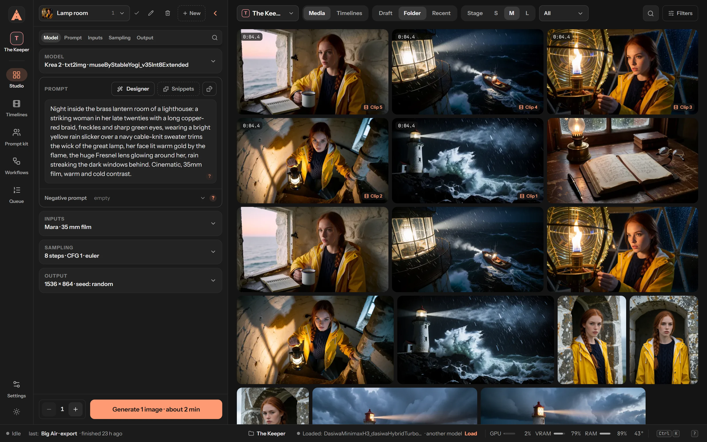
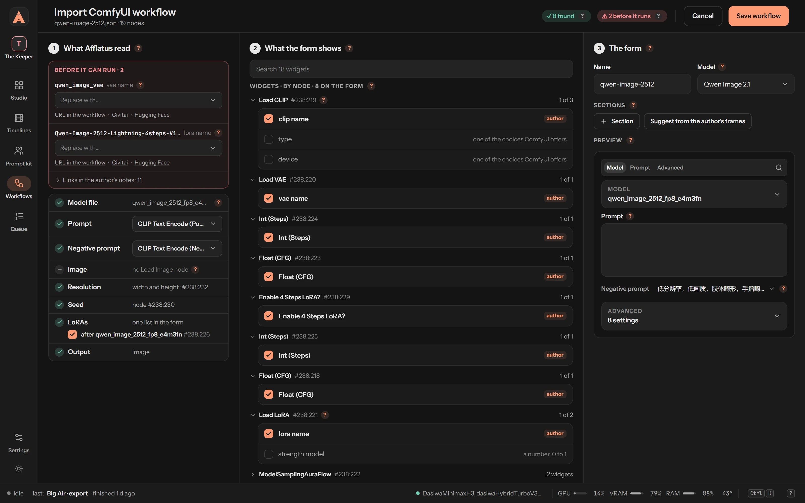
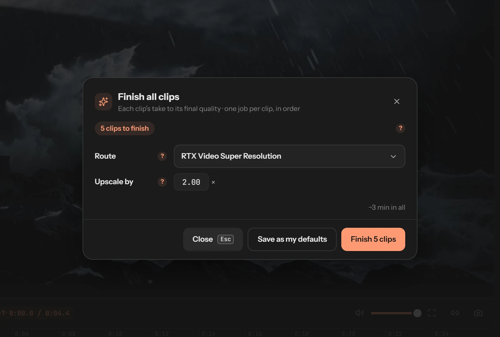

<h1 align="center">Afflatus</h1>

  A self-hosted studio for pictures, videos and timelines, in front of your own <a href="https://github.com/Comfy-Org/ComfyUI">ComfyUI</a>.

  
  
  

https://github.com/user-attachments/assets/e217e91c-bbf2-4642-8468-3176c35368ca

Everything in this video was made in Afflatus, the logo included. The snowboard film at the start: Krea 2 key frames and a MiniMax H3 chain. <a href="https://github.com/user-attachments/assets/ad78668c-1474-4c78-9b75-f4b281f6347f">Watch the film on its own</a>.

**You love what ComfyUI can do, but you miss a real library, simple forms and an editor for video.** Afflatus is that app, built around the ComfyUI you already run. Your GPU, your models, your node packs: Afflatus just gives you a better place to work.

It is one small server and a folder of data, on your PC or in a container, talking to ComfyUI over HTTP. Nothing runs in the cloud.

## What you get

- **Every render remembered.** Each picture and clip keeps the exact settings it was made with. Open any of them, change one thing, render again.
- **Forms instead of noodles.** A clean form per model, with good defaults already in it: prompt, size, steps, done. The graph is still there when you want it.
- **Your own workflows, as forms.** Drop in a ComfyUI workflow file and Afflatus turns it into a form, keeps the controls its author put forward, and tells you which node packs and models are missing.
- **Picture to video in one click.** Like a picture? Open it and press **M**. Pin a first frame, a last frame or a keyframe in the middle, and the model fills in the motion.
- **A timeline for real videos.** Chain clips into one film, with several takes per clip, trims, music that ducks under voices, and one export. MiniMax H3 clips carry on from the previous clip's latent, so motion and sound flow across the cut.
- **It measures what it makes.** Generation is only half the job. Every take is scored on how cleanly it joins the clip before and how its brightness, sharpness and pace compare. The timeline points out the joins that jump; which take makes the better clip stays your call.
- **It learns your machine.** Before you press Generate, the form tells you how long it will take, learned from your own past renders. While it runs, you watch a live preview.
- **Everything in reach.** Projects, a bin that cleans itself, a Prompt kit for people and styles, and **Ctrl+K** to find or do anything from the keyboard.

## From download to your first render

You need **ComfyUI** running somewhere (a clone, the portable build or the desktop app) and any card ComfyUI runs on. Afflatus does not install ComfyUI for you.

1. **Download and start.** Grab the bundle for your system from the [releases page](https://github.com/bardak971/afflatus/releases), unpack it and run `Afflatus.bat` (Windows) or `afflatus.sh` (Linux, macOS). Your browser opens on `http://127.0.0.1:8720`.
2. **Connect ComfyUI.** In **Settings → ComfyUI**, enter its address (`http://127.0.0.1:8188` on the same machine) and press **Test**. Give it ComfyUI's folder too, so Afflatus can install its small node pack.
3. **Get a model.** **Settings → Models** shows, for each model family, what is ready and what is missing, file by file. Turn on ComfyUI-Manager in ComfyUI ([how](docs/comfyui-setup.md#comfyui-manager-for-downloads)) and Afflatus downloads the missing files for you, or put them in place yourself.
4. **Make a picture.** Open the **Studio**, press **N** for the form, pick a model, write a prompt and press **Ctrl+Enter**. It lands in your library with everything it was made with.
5. **Make it move.** Open the picture, press **M** (image to video), describe the motion and render. Then drop clips on a **Timeline** to build a film.
6. **Bring your own workflow.** Have a graph you love in ComfyUI? **Workflows → Import** the `.json` you saved from it, and use it like any other form.

Other ways to run it:

| Platform | How |
|---|---|
| Windows | Unzip `afflatus-<version>-win-x64.zip`, double-click `Afflatus.bat` |
| Linux ¹ | `tar xzf afflatus-<version>-linux-x64.tar.gz`, run `afflatus.sh` |
| macOS, Apple Silicon ¹ | `tar xzf afflatus-<version>-darwin-arm64.tar.gz`, run `afflatus.sh`; `brew install ffmpeg` once |
| Docker | `docker run -p 127.0.0.1:8720:8720 -v afflatus-data:/data ghcr.io/bardak971/afflatus:latest`, or the [compose.yaml](compose.yaml) ([guide](docs/install-docker.md)) |
| Kubernetes | the Helm chart in [chart/](chart) ([guide](docs/install-cluster.md)) |
| From the sources | Node 22.16+ and ffmpeg: `corepack pnpm install && corepack pnpm build && corepack pnpm start` |

¹ Built by the release workflow but not yet started on a real machine. Reports welcome.

No GPU at hand? `corepack pnpm demo` runs the real app against a pretend ComfyUI, with its own data in `./data-demo`.

More help: [installing on a PC](docs/install-desktop.md) · [setting up ComfyUI](docs/comfyui-setup.md) · [using Afflatus](docs/guide.md) · [configuration](docs/configuration.md) · [troubleshooting](docs/troubleshooting.md)

> [!WARNING]
> **There is no login.** Anyone who can reach Afflatus's port can use your library, your settings and your GPU. It only listens on your own machine unless you tell it otherwise. Never put it on the internet as it is: put a reverse proxy with its own login in front. See [SECURITY.md](SECURITY.md).

## A tour

### The Studio

Where you make things and where they stay. The form on the left, your library on the right: search your prompts, filter by model or LoRA, compare two takes side by side. Right-click anything to see what you can do with it next: reuse its settings, upscale, fix a face, inpaint, mirror, turn it into a video.

### Your workflows, as forms

Import the workflow file you saved from ComfyUI and Afflatus reads it for you. It keeps the controls the author put forward, turns their switches into toggles, finds where LoRAs go, and names every node pack and model file you are missing, with a button to install them through ComfyUI-Manager. From then on it is a form like any other, with its renders in your library.

### The timeline

Turn clips into a film. Each clip is a form of its own with as many takes as you like; pick the one that plays. A clip can carry on from the one before, so the motion and the sound keep going across the cut. Trim with scene detection, hold a picture as a still, add music that ducks under voices, then export one video with its colours matched across the cuts, or a small copy for the web.

### What it measures

Hover a clip, or open its takes, and you see how clean each join is and how its brightness, sharpness and pace compare with the clips around it. Nothing is guessed: the figures come from the frames. When a join jumps, the timeline tells you which take would join more cleanly, and you decide.

### And more

<table>
<tr>
<td width="50%"> <b>Projects.</b> Every project with its folders, drafts and timelines, what it holds and what it weighs. Renders you don't keep go to the bin after a day and the bin empties itself after a week, or as long as you set.</td>
<td width="50%"> <b>The Prompt kit.</b> People, places, styles and snippets, written once and used with every model: tags for SDXL, a sentence and reference pictures for the newer ones.</td>
</tr>
<tr>
<td> <b>Ctrl+K.</b> Find any draft, render, timeline or setting across your projects, with a preview. Queue, reuse, split, flip a setting or work out frames and seconds without leaving the keyboard.</td>
<td> <b>Finish.</b> Bring every clip to its final size in one go: SeedVR2, RTX Video Super Resolution or an upscale model. A finished take keeps its draft's timing.</td>
</tr>
<tr>
<td> <b>Render times.</b> Where your GPU's time went, by model and phase, with the jobs that ran slower than usual or out of video memory.</td>
<td> <b>Models.</b> What each model family has ready and what is missing, with the folder each file goes in and a Download button.</td>
</tr>
</table>

 Studio Dark by default, plus light and dark themes from Studio, Catppuccin, Rosé Pine, Tokyo Night and Kanagawa.

Also in the app: an optional **prompt designer** that writes prompts following each model's guide, through any OpenAI-style language model (LM Studio, Ollama, llama.cpp or a service).

## Built-in model families

These come with a ready-made form. Anything else, bring in as a workflow.

| Family | Models | What you can do |
|---|---|---|
| SDXL | any SDXL checkpoint: Illustrious, NoobAI, Pony, Juggernaut XL… | txt2img, img2img, inpaint, outpaint, upscale, face detailer |
| FLUX.2 Klein | 4B base and its fine-tunes | txt2img, edit by instruction, variation, inpaint, outpaint, upscale, face detailer |
| Krea 2 | Turbo and its fine-tunes | txt2img, img2img, inpaint, upscale, face detailer |
| FLUX.1 ² | dev, Kontext | txt2img, edit, img2img, inpaint, outpaint, upscale, face detailer |
| Qwen Image | 2512, Qwen Image Edit | txt2img, edit, img2img, inpaint, outpaint, upscale, face detailer |
| Qwen Image 2.1 ² | | txt2img, edit |
| MiniMax H3 | video with sound | text, first frame, first and last frames, references, continuation: the timeline's native model |
| Wan 2.2 | | video |
| LTX 2.3 | | video |
| Image tools | SeedVR2, background removal | restore and upscale, remove the background |

² Built from the model cards and not yet run against the models.

The default files are ComfyUI's own releases on Hugging Face. Some options need a custom node pack; when one is missing, Afflatus tells you which and how to install it ([the list](docs/comfyui-setup.md#node-packs)).

**Model licences.** The models are other people's work under their own licences, which you accept when you download them. The shipped presets bundle nothing; each shows its licence and asks you to accept it once. Read them: several are community licences with limits on commercial use, and **MiniMax H3's licence does not grant its use in the European Union, the United Kingdom, South Korea or the United States** (its "Excluded Territories"). It also asks that machine-made content shown in public be disclosed as such.

## Your data

Everything (library, settings, timelines) lives in the `data` folder next to the launcher, or in the `/data` volume. To update, unpack the next release over the old one or pull the next image; the database updates itself when it starts. A backup is one zip from **Settings → Storage**.

## Status

Afflatus is 0.x and made for one person at a time. It is used every day on one machine and has not yet run on many, so expect rough edges and changes between minor versions. What changed in each release is in the [changelog](CHANGELOG.md).

## Contributing

Bug reports, fixes and new model families are welcome. See [CONTRIBUTING.md](CONTRIBUTING.md) for the setup, the checks and the conventions, and the [Code of Conduct](CODE_OF_CONDUCT.md). Security problems go through [private reporting](SECURITY.md).

## Licence and credits

Afflatus is under [AGPL-3.0](LICENSE). Its node pack for ComfyUI in [comfy-nodes](comfy-nodes) is MIT.

- [ComfyUI](https://github.com/Comfy-Org/ComfyUI), which does all the rendering.
- The node pack vendors the MIT continuation nodes of ttulttul's [ComfyUI-Minimax-H3-Continuation](https://github.com/ttulttul/ComfyUI-Minimax-H3-Continuation), with one small change (a guarded import).
- The authors of the node packs listed in [ComfyUI setup](docs/comfyui-setup.md#node-packs).
- The shipped presets point at the official model releases (Krea, MiniMax, Wan, Lightricks) on Hugging Face; each names its maker and its licence. Nothing of theirs is bundled.
- The ffmpeg builds in the Windows and Linux bundles are the LGPL builds by [BtbN](https://github.com/BtbN/FFmpeg-Builds).
- Every release carries `THIRD_PARTY_NOTICES.txt`: the npm packages and fonts it ships, with their licences.
